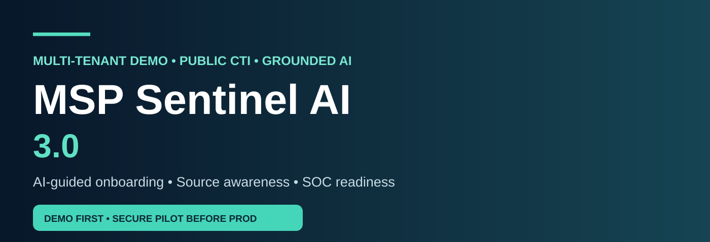
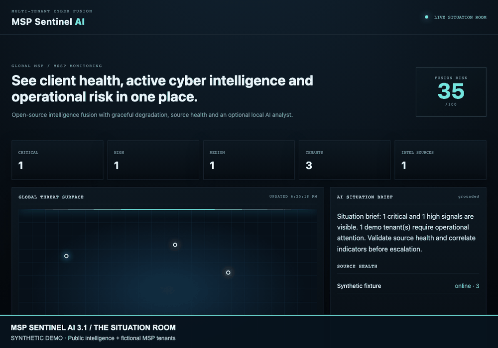
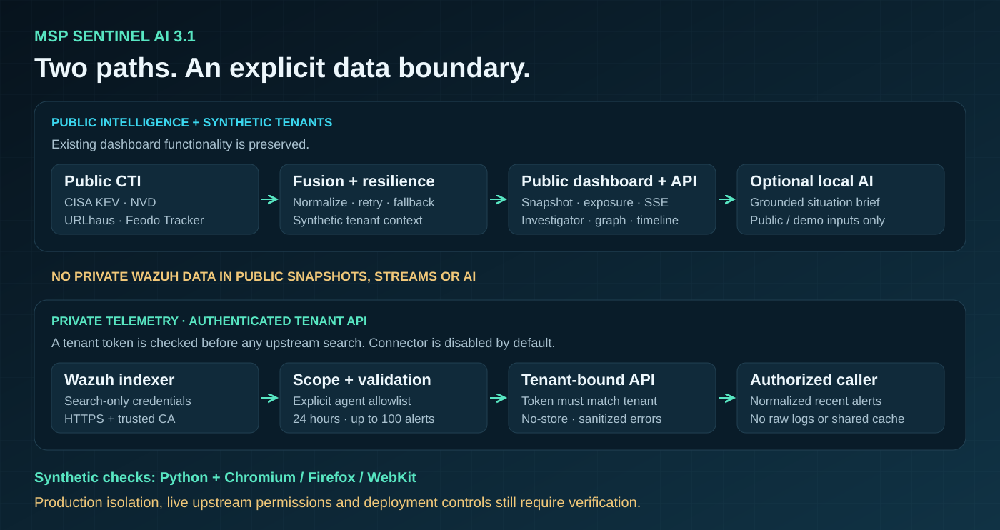
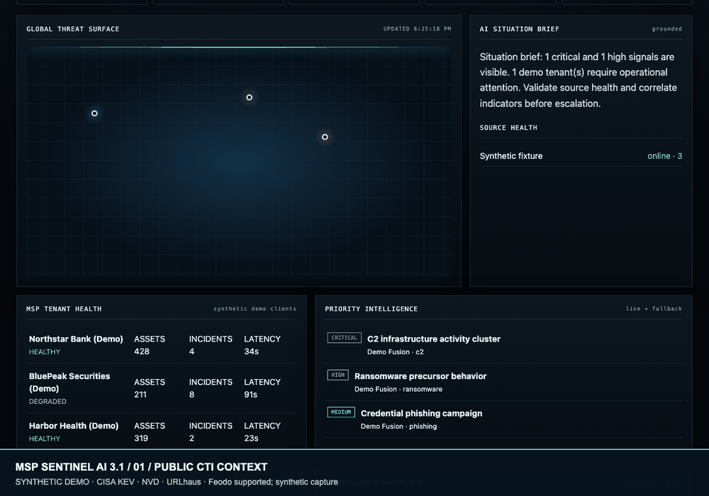
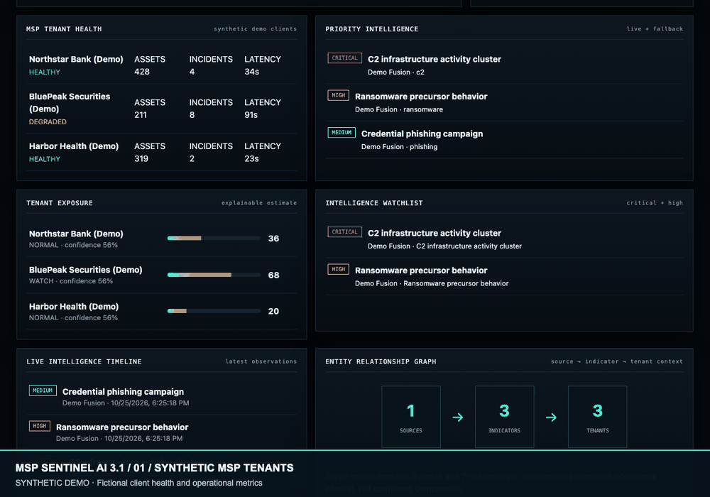
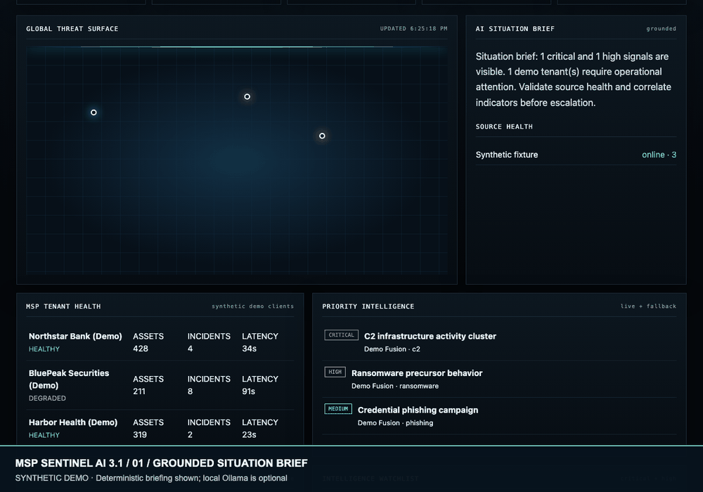

<div align="center">



# MSP Sentinel AI 3.1

**AI-guided infrastructure intake · Public CTI fusion · Multi-tenant synthetic SOC demonstration**





</div>

## New in 3.1

- Optional read-only Wazuh indexer alert search through an authenticated tenant API
- Explicit agent assignments, scoped queries, result validation and private-response cache safeguards
- Synthetic integration tests, a local HTTPS contract test and expanded three-browser CI verification
- Existing public dashboard, synthetic demos, planner, CTI, SSE and local AI remain available

Read [connector setup, verified safeguards and limitations](docs/wazuh-3.1.md).
Private telemetry is kept separate from public routes and AI. Synthetic verification
**does not establish production-ready tenant isolation** or validate a live Wazuh deployment.
The existing visual assets below illustrate the prior dashboard design.

## 🤖 AI-ready: one question at a time

Give an assistant capable of reading GitHub files this prompt:

```text
Read AGENTS.md and AI_INSTRUCTIONS.md from this repository.
Ask me one question at a time, starting with which SIEM I use.
Learn my MSP tenant count, telemetry, intelligence feeds, deployment
environment, approved local AI, security controls and applicable
frameworks. Produce an infrastructure-specific adoption plan,
identifying what is already implemented versus missing for production.
Do not ask for secrets or assume customer integrations are live.
```

**URL sharing alone does not activate AI guidance on every platform.** The repository provides prompts for compatible assistants; it does not contain a hosted conversational onboarding service.

### Generate an offline infrastructure plan

```bash
python scripts/build_deployment_plan.py --input examples/msp-environment.sample.json --output /tmp/msp-plan.md
```

This creates a planning document only; it does not call the application or collect customer data.

### Compliance and security

The [12-reference applicability matrix](docs/compliance-applicability.md) includes the requested regulatory and standards context, with qualifications. It is **not** a compliance certificate. Existing tenant data are synthetic, and production requires tenant authorization, identity, isolation, storage, audit logging and connector validation.

---

## Existing project features and instructions


**Open-source multi-tenant MSP/MSSP Cyber Situation Room** — a Python-first browser dashboard that fuses public cyber threat intelligence, tenant operational health and optional local AI analysis into one live defensive view.

> Built as an original MSP/SOC-focused project. It is inspired by the resilience and situational-awareness patterns of modern intelligence dashboards, not a clone of any vendor map or reference repository.

<p align="center">
  
</p>

> **Live visual:** the animation is generated from this project's own SOC design language and demonstrates threat-surface activity, fusion risk, tenant health, source health, and the grounded AI situation brief.

## Why this exists

Public threat maps are useful for global context, while MSP teams also need to know **which client needs attention, whether telemetry is healthy, what threat intelligence matters, and whether the upstream feeds themselves are trustworthy right now**. MSP Sentinel AI combines those questions into one operator-oriented interface.

## Highlights

- Multi-tenant MSP/MSSP health view with synthetic demo clients
- Public CTI fusion: CISA KEV, NVD, URLhaus and Feodo Tracker
- Global geospatial threat surface for signals that contain location context
- Explainable tenant exposure scoring with confidence and detection-coverage context
- IOC/intelligence investigator across the current fused snapshot
- Entity relationship graph model linking sources, indicators and tenant context
- Critical/high intelligence watchlist and chronological intelligence timeline
- Concurrent asynchronous collection with retries and circuit breakers
- Explicit source-health states and graceful fallback instead of fake zeroes
- Severity fusion and operational risk scoring
- Optional local Ollama analyst; deterministic grounded brief when no LLM is configured
- FastAPI REST endpoints plus Server-Sent Events stream
- Responsive dark SOC dashboard for modern browsers
- Docker support and Python 3.12+
- GitHub CI for Python 3.12/3.13 and a Chromium/Firefox/WebKit browser matrix

## Threat intelligence fusion

MSP Sentinel AI collects multiple public intelligence feeds concurrently, normalizes the observations and correlates them into a single operational risk view. Feed failures remain visible as source-health degradation instead of being interpreted as zero threat activity.

<p align="center">
  
</p>

## Multi-tenant MSP operations

The tenant view is designed for MSP/MSSP operations where analysts need to distinguish customer health from global threat context. Synthetic demo tenants illustrate asset coverage, log-source status, open incidents, ingest latency and detection coverage without exposing customer data.

<p align="center">
  
</p>

## Grounded AI SOC analyst

The optional AI layer is deliberately downstream of telemetry and CTI collection. It summarizes observed evidence, enrichment and ATT&CK-style context while preserving human review before response actions.

<p align="center">
  
</p>

> AI-generated analysis is decision support. Public CTI correlation is contextual evidence and must be validated against endpoint, network or SIEM telemetry before incident response.

## Quick start

```bash
git clone https://github.com/amitambekar510/msp-sentinel-ai.git
cd msp-sentinel-ai
python -m venv .venv
# Windows: .venv\Scripts\activate
# Linux/macOS: source .venv/bin/activate
python -m pip install --upgrade pip
pip install -e ".[dev]"
python -m msp_sentinel.cli
```

Open **http://127.0.0.1:8000**.

You can also run `msp-sentinel --host 0.0.0.0 --port 8000` after installation.

## Docker

```bash
cp .env.example .env
docker compose up --build
```

Then open **http://127.0.0.1:8000**.

## API

| Endpoint | Purpose |
|---|---|
| `GET /` | Browser Situation Room |
| `GET /api/health` | Application health |
| `GET /api/snapshot` | Current fused situation snapshot + exposure, graph, timeline and watchlist |
| `GET /api/exposure` | Tenant exposure estimates and priority watchlist |
| `GET /api/investigate/{indicator}` | Search an IOC/CVE/domain/title/source in the current snapshot |
| `GET /api/stream` | Live SSE situation stream |
| `GET /api/tenants/{tenant_id}/wazuh` | Authenticated, scoped Wazuh indexer alert search (optional) |

## Optional local AI analyst

The project does not require a cloud LLM. To use a local Ollama model:

```env
MSP_SENTINEL_OLLAMA_URL=http://localhost:11434
MSP_SENTINEL_OLLAMA_MODEL=your-installed-model
```

If the model is unavailable, the dashboard automatically falls back to a deterministic situation brief. The AI prompt is explicitly grounded in the collected snapshot and instructed not to invent facts.

## Intelligence & exposure workspace

The existing workspace extends the Situation Room from global awareness into an MSP-oriented decision path: **public intelligence → normalized signal → tenant exposure context → detection coverage → analyst investigation**. Exposure values are explicitly estimates derived from public CTI and synthetic tenant telemetry; they do not assert that a customer is compromised.

The entity graph is intentionally lightweight and API-friendly. It represents relationships between intelligence sources, indicators and demo tenants so future integrations can replace synthetic context with authorized CMDB, SIEM, EDR or asset-inventory data.

## Intelligence architecture

```text
 CISA KEV ─┐
 NVD ──────┤
 URLhaus ──┼─> async collectors -> retry/circuit breaker -> fusion engine
 Feodo ────┘                                      │
                                                  ├─> risk/severity model
 Synthetic MSP tenant telemetry ──────────────────┤
                                                  ├─> grounded AI brief
                                                  └─> REST / SSE / browser dashboard
```

The collector boundary is intentionally small so additional feeds can be added without changing the dashboard contract. Production users should respect each provider's terms, rate limits and authentication requirements.

## Data integrity and safe degradation

A failed upstream source is marked **degraded**. It is not silently interpreted as “no threats.” When all public sources are unreachable, the application uses clearly labelled synthetic signals so the UI remains demonstrable. Demo tenant records are fictional and must not be confused with customer telemetry.

## Production extension ideas

The repository is designed as a foundation for integrations such as OpenCTI, MISP, Elastic Security, Microsoft Sentinel, CrowdStrike, ticketing systems and tenant-specific asset inventories. Before production use, add authentication/RBAC, persistent storage, secrets management, audit logging, tenant isolation, feed-specific licensing review, rate limiting and organization-specific incident workflows.

## Testing

```bash
pytest -q
python -m compileall -q msp_sentinel
```

GitHub Actions tests Python 3.12 and 3.13. A separate browser workflow starts an offline synthetic fixture and verifies dashboard behavior, investigation, SSE and tenant access in **Chromium, Firefox and WebKit**, saving screenshots as CI artifacts.

## Security and limitations

This is a defensive situational-awareness project, not a replacement for a SIEM, EDR, SOC analyst or incident-response process. Public-feed indicators can be stale, incomplete, false-positive or context-dependent. Never treat a map marker or public IOC as proof that an organization is compromised. See [SECURITY.md](SECURITY.md).

## Attribution

Architecture research included the public World Intel MCP project and public threat-intelligence dashboards from Kaspersky, Check Point, Radware, Bitdefender, NETSCOUT, FortiGuard, SonicWall, Cisco Talos and Spamhaus. MSP Sentinel AI uses its own implementation and UI and does not redistribute proprietary dashboard data.

## License

MIT © 2026 Amit Ambekar.
